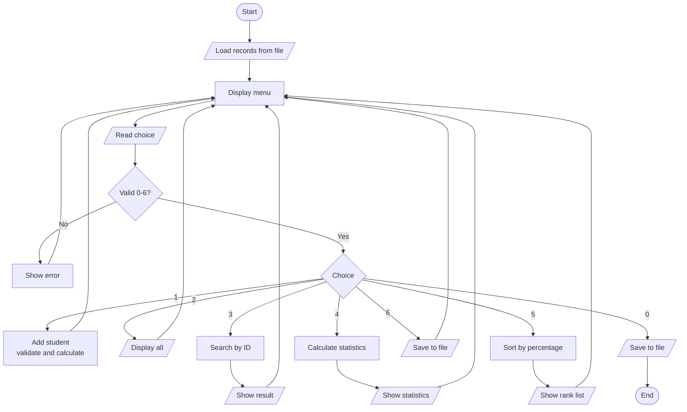
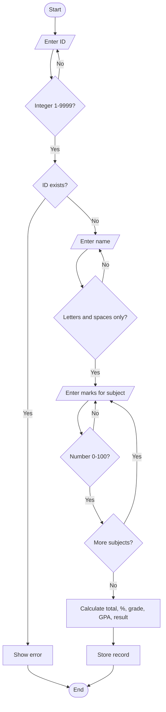
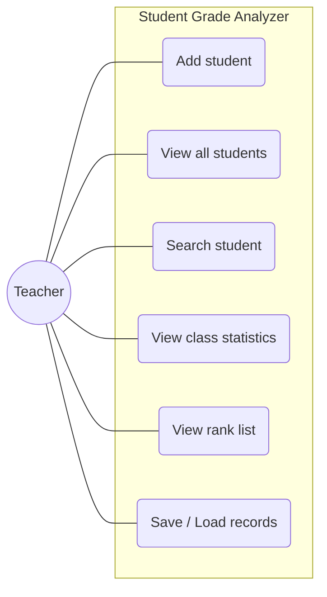
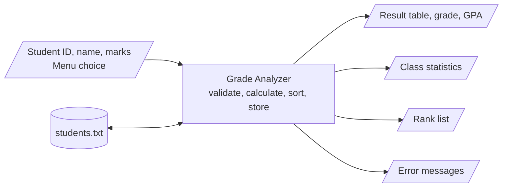

# Student Academic Performance & Grade Analyzer
**Course:** Project I (BITP 141) | **Program:** BIT, Semester I | **Institution:** Sofan Western Academy
**Student:** _[Suraj Rana]_ | **Roll No.:** _[101]_ | **Submitted to:** _[Teacher Name]_ | **Date:** _[Date]_

---

## 1. Introduction

### 1.1 Problem Statement
In many campuses, student marks are still recorded in notebooks or scattered spreadsheets. Calculating totals, percentages, grades and class rankings by hand is slow and error-prone, and teachers cannot quickly see which subjects or students need attention.

### 1.2 Objective
To build a simple, menu-driven command-line program in C that:
- records marks of students in 5 subjects,
- automatically calculates total, percentage, grade, GPA and Pass/Fail,
- produces class statistics and a rank list,
- stores data permanently in a file, and
- rejects invalid input safely.

### 1.3 STREAME Mapping

| Component | How this project uses it |
|---|---|
| **Science** | Statistical calculation: mean, highest, lowest, pass rate, subject-wise averages. |
| **Technology** | C programming, structures, arrays, functions and file handling automate manual work. |
| **Research** | Marks are collected as data; subject averages reveal weak subjects, supporting data-driven decisions. |
| **Engineering** | Modular design, input validation and testing follow a systematic engineering approach. |
| **Management** | Record keeping with add/search/rank features helps teachers manage student information. |
| **Entrepreneurship** | Replaces paid software and paper registers at near-zero cost; can be extended into a product for small schools/tuition centres. |

*(Assignment requires at least 3; this project covers all 6 meaningfully, with Science, Technology, Research, Management as the strongest.)*

---

## 2. Design

### 2.1 Functional Requirements
| ID | Requirement |
|---|---|
| FR1 | Add a student with unique ID, name and marks in 5 subjects. |
| FR2 | Reject marks outside 0–100, non-numeric input, duplicate IDs and invalid names. |
| FR3 | Calculate total, percentage, grade, GPA and Pass/Fail automatically. |
| FR4 | Display all students in a table. |
| FR5 | Search a student by ID and show subject-wise marks. |
| FR6 | Show class average, highest, lowest, pass/fail count, pass rate and subject averages. |
| FR7 | Show a rank list sorted by percentage (highest first). |
| FR8 | Save records to `students.txt` and load them on the next start. |

**Non-functional:** easy menu, no crashes on bad input, readable and commented code.

**User needs:** Teacher / class coordinator who needs quick results without manual calculation.

### 2.2 Grading Rules
| Percentage | Grade | GPA |
|---|---|---|
| 90–100 | A+ | 4.0 |
| 80–89.99 | A | 3.6 |
| 70–79.99 | B+ | 3.2 |
| 60–69.99 | B | 2.8 |
| 50–59.99 | C+ | 2.4 |
| 40–49.99 | C | 2.0 |
| below 40 | F | 0.0 |

A student must score **at least 40 in every subject** to pass. Failing any one subject gives result *Fail* and grade *F*, whatever the average.

### 2.3 Algorithm / Pseudocode (core logic)

**Add student and calculate result**
```
START addStudent
    IF count >= MAX_STUDENTS THEN display "Storage full"; RETURN
    READ id  (repeat until integer 1..9999)
    IF id already exists THEN display error; RETURN
    READ name (repeat until only letters/spaces)
    FOR each subject i = 1 to 5
        READ marks[i] (repeat until number 0..100)
    END FOR
    total = 0 ; passed = TRUE
    FOR i = 1 to 5
        total = total + marks[i]
        IF marks[i] < 40 THEN passed = FALSE
    END FOR
    percentage = total / 5
    (grade, gpa) = gradeFromPercentage(percentage)
    IF passed = FALSE THEN grade = "F"; gpa = 0
    STORE student in list ; count = count + 1
END
```

**Rank list**
```
FOR i = 0 to count-2
    FOR j = 0 to count-2-i
        IF percentage[order[j]] < percentage[order[j+1]] THEN swap order[j], order[j+1]
PRINT students in order[] with rank 1,2,3...
```

### 2.4 Flowchart (main program)



**Flowchart for "Add Student" validation**


### 2.5 Use Case Diagram



### 2.6 System Context Diagram (Input → Process → Output)



### 2.7 Data Structure
```c
typedef struct {
    int id; char name[50]; float marks[5];
    float total, percentage, gpa; char grade[3]; int passed;
} Student;
```
Records are held in an array `Student students[50]`. File format: one line per student, `id,name,m1,m2,m3,m4,m5`. Derived values are recalculated on load so the file cannot hold inconsistent results.

---

## 3. Implementation

### 3.1 Concepts Used
| Concept | Where |
|---|---|
| Variables, data types | `int`, `float`, `char[]` throughout |
| Control structures | `if/else`, `switch` menu, `for`, `do-while`, `while` |
| Functions (modular) | `readInt`, `readFloat`, `isValidName`, `calculateResult`, `gradeFromPercentage`, `addStudent`, `showStatistics`, `showRankList`, `saveToFile`, `loadFromFile` |
| Arrays | `students[]`, `marks[]`, `SUBJECT_NAMES[]`, `order[]` |
| Structures | `Student` |
| File handling | `fopen`, `fprintf`, `fgets`, `sscanf`, `fclose` |
| Sorting | Bubble sort on an index array |

### 3.2 Defensive Programming
- All input is read with `fgets` and converted with `strtol`/`strtod`, so letters or empty input cannot crash the program (unlike a raw `scanf`).
- Range checks for menu, ID and marks; name check for letters/spaces only.
- Duplicate ID check; storage-full check; empty-list checks; file-open failure message; corrupted file lines skipped.

### 3.3 Build and Run
```
gcc -std=c99 -Wall -Wextra -o grade_analyzer src/main.c
./grade_analyzer
```
Compiled with **zero warnings** using GCC 13.

---

## 4. Testing and Results

| # | Test Description | Test Data | Expected Output | Actual Output | Status |
|---|---|---|---|---|---|
| 1 | Valid student | ID 101, Ram Sharma, marks 85, 78, 92, 88, 70 | Total 413, 82.60%, grade A, GPA 3.6, Pass | `101 Ram Sharma 413.00 82.60% A 3.60 Pass` | Pass |
| 2 | Invalid marks | Maths marks `150`, then `abc`, then `-5`, then `60` | Error for each bad value; asks again; accepts 60 | `Invalid marks. Enter a number from 0 to 100.` (3 times), then "Student added successfully." | Pass |
| 3 | Duplicate ID | Add ID 101 twice | Second attempt rejected | `Error: ID 101 already exists.` | Pass |
| 4 | Fail in one subject, high average | ID 103, marks 95, 95, 95, 95, 35 | Average 83% but result Fail, grade F | `103 Hari Thapa 415.00 83.00% F 0.00 Fail` | Pass |
| 5 | Invalid menu / name / missing ID | Menu `9`, `x`; name `R@m123`; search ID 999 | Errors; program does not crash | `Invalid input. Enter a whole number from 0 to 6.` ×2; `Invalid name. Use letters and spaces only.`; `Student with ID 999 not found.` | Pass |
| 6 | Class statistics | 3 students (Asha 91.2%, Bikash 53.6%, Chandra 34%) | Average 59.60%, 2 pass / 1 fail, pass rate 66.67% | Average 59.60%, Highest Asha, Lowest Chandra, Passed/Failed 2/1, Pass rate 66.67% | Pass |
| 7 | Rank list | Asha 91.2%, Bikash 53.6% | Asha rank 1, Bikash rank 2 | `1 1 Asha … 91.20% A+` then `2 2 Bikash … 53.60% C+` | Pass |
| 8 | File persistence | Add ID 7 Gita (80 ×5), exit, restart | Record reloaded | File line `7,Gita,80.00,…`; on restart `Loaded 1 record(s)` and Gita shown | Pass |
| 9 | Empty database | Choose Display/Statistics with no data | Friendly message | `No records available.` | Pass |

### Debugging Notes
- **Issue 1:** Using `scanf("%d")` looped forever when a letter was typed. **Fix:** switched to `fgets` + `strtol` with validation.
- **Issue 2:** The rank-list header printed misaligned. **Fix:** printed a dedicated header with a Rank column.
- **Issue 3 (design):** A student could get a high grade with a failed subject. **Fix:** added the per-subject pass rule and the grade override.

### Results
The program meets all 8 functional requirements. All 9 test cases passed.

### Limitations and Future Work
- Maximum 50 students and fixed 5 subjects (could use dynamic memory and configurable subjects).
- Edit/delete record feature not included.
- Could add a GUI, CSV export, or graphs later.

### Conclusion
The project applies first-semester C concepts and the STREAME framework to a real campus problem and gives a working, tested, user-friendly tool.

---
*GitHub Repository:* _[paste link here]_
